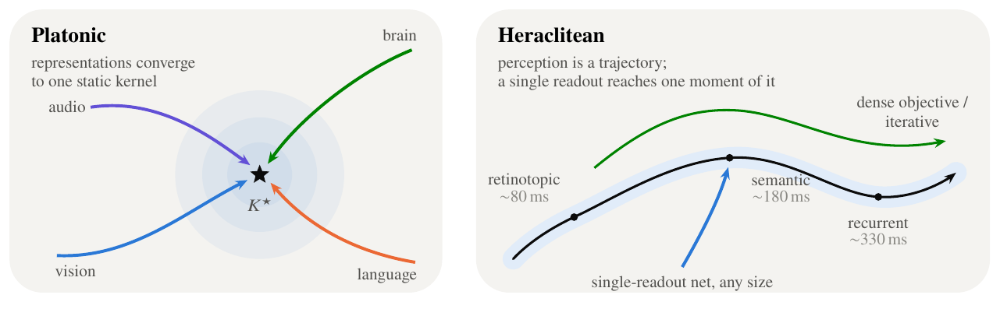

<div align="center">

# The Heraclitean Representation Hypothesis

**What a network is trained to predict, not its size, sets which moment of perception it matches.**

[Methodology](METHODS.md) · [Run it](RUNNING.md)


</div>

> *"You could not step twice into the same river."* (Heraclitus)

The [Platonic Representation Hypothesis](https://arxiv.org/abs/2405.07987) (Huh et al., 2024)
holds that as networks scale, their representations converge to one static model of reality.
The brain does not compute one representation, though: within ~400 ms, visual cortex moves
through retinotopic, semantic and recurrent regimes.

**HRH** treats a representation as a trajectory and asks which part of the brain's trajectory a
network can match. Our answer has three parts.

1. **Scale does not move it.** Across 25 models in six scaling ladders (6M to 1.8B parameters),
   alignment with THINGS-EEG2 is flat in model size in every time window. The same pipeline
   detects objective effects four to six times larger, so this is not a sensitivity problem.
2. **The objective fixes a spectral trajectory.** In deep linear networks under natural-image
   statistics, the layers of a trained network pass through a sequence of representational
   spectra that runs from the input's to an endpoint set by the objective. Width does not
   enter, and depth only refines the steps. Alignment with a brain stage peaks when the spectra
   match.
3. **A brain-free law, tested out of sample.** From properties measured without any neural data
   (spectral exponents, low-level and semantic retention), we fit a law on 33 development models
   and **pre-register its predictions for 18 held-out models** before their brain alignment is
   computed.

<p align="center"></p>

## Status

| | |
|---|---|
| Theory | done: spectral matching and spectral trajectories (`hrh/theory.py`, `tests/test_theory.py`) |
| Development study | done: 33 models × 10 subjects |
| Brain-free proxies and law | implemented (`hrh/proxies.py`, `hrh/law.py`) |
| Held-out test | predictions to be registered in [`registration/`](registration/) before analysis |

## Quickstart

```bash
git clone https://github.com/LegallyCoder/hrh && cd hrh
pip install -e ".[dev]"          # numpy + matplotlib; add ".[models]" for torch/timm/transformers
make test                        # synthetic ground truth, theory, proxies, law (~20 s, CPU)
```

The full pipeline (GPU) is in [RUNNING.md](RUNNING.md) and `notebooks/hrh_colab.ipynb`.

## Layout

```
hrh/            align, brain, features, trajectory, theory, proxies, law, evaluate, plotting, data
run_hrh.py      brain | features | eval | proxies | law | predict | analyze | figures
registration/   registered held-out predictions (JSON + SHA-256)
tests/          synthetic ground truth and theory checks (run in CI)
notebooks/      end-to-end GPU notebook
```

## License

Code: MIT. THINGS-EEG2 and model weights are subject to their own licenses.
